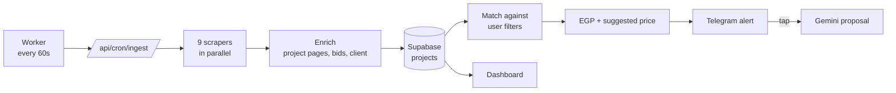

<div align="center">

# 📡 PingLead

**Real-time freelance project radar for Arab & global freelancers**

Catch new client projects from 9 freelance platforms the moment they're posted, get instant Telegram alerts with competition and client insights, and send a tailored AI proposal in one tap.

[](https://nextjs.org)
[](https://react.dev)
[](https://www.typescriptlang.org)
[](https://supabase.com)
[](https://ai.google.dev)
[](https://core.telegram.org/bots)

</div>

<div dir="rtl">

> **بالعربي:** PingLead رادار بيراقب مستقل وخمسات ونفذلي وكفيل و5 منصات عالمية، ويبعتلك على تليجرام أول ما ينزل مشروع يطابق فلاترك. التنبيه بيوصل ومعاه عدد العروض اللي اتقدمت، وتقييم صاحب المشروع، والميزانية بالجنيه، وسعر مقترح. وبضغطة زرار بيكتبلك عرض احترافي بالذكاء الاصطناعي بناءً على سابقة أعمالك.

</div>

---

## Table of contents

- [Features](#-features)
- [Supported platforms](#-supported-platforms)
- [How it works](#-how-it-works)
- [Tech stack](#-tech-stack)
- [Getting started](#-getting-started)
- [Environment variables](#-environment-variables)
- [Scripts](#-scripts)
- [Database](#-database)
- [Project structure](#-project-structure)
- [Deployment notes](#-deployment-notes)
- [Roadmap](#-roadmap)
- [Contributors](#-contributors)

---

## ✨ Features

### 🎯 Smart project radar
- Scrapes **9 freelance platforms** and rotates through **14 specializations**, covering every category roughly every 7 minutes.
- **Smart filters** per user: platforms, categories, include/exclude keywords with Arabic normalization (أ/إ/آ, ة/ه, ى/ي, diacritics), and a minimum budget in **USD or EGP**.
- Each match is alerted **once**, so you never see the same project twice.

### 🏁 Competition & client insights
- **Bid count** on every project the platform exposes it for, with a verdict: 🟢 low · 🟡 medium · 🔴 high competition.
- **Client signals**: hire rate, open projects, projects in progress, registration date, country.
- **Full project description** read from the project page (Mostaql), so AI proposals see the real requirements.

### 💰 Pricing for the Egyptian market
- Every budget shown with its **EGP equivalent**, using a daily exchange rate for 166 currencies.
- **Instant suggested bid** (price + delivery time) for each project, based on the client's budget, the median of similar recent projects, the platform's average bid, and how crowded the project is. Free, with no AI credits used.

### ✍️ AI proposals (Google Gemini)
- One-tap proposal from the dashboard or straight from Telegram.
- Uses your bio, skills, tone of voice, and automatically cites your **best-matching portfolio items** with live links.
- Starts from the suggested price and adjusts it to the real scope, proposing milestones when the work splits naturally.

### 🤖 Telegram bot
- **One-click linking**: press "Connect Telegram", tap Start, done. No chat IDs to copy.
- Rich alert cards with budget, EGP, suggested price, competition, client, and delivery time.
- Inline buttons: **Write AI proposal** · **Open project** · **Mark as applied**.

### 📋 Mini CRM & automation
- Track projects as saved / applied / won, keep proposal templates, and manage a portfolio vault.
- Auto-bidding queue with match scoring, schedules, daily limits, and A/B template testing (proposals wait for your approval).

---

## 🌐 Supported platforms

| Platform | Region | Projects | Bid count | Client info |
|---|---|:---:|:---:|:---:|
| [Mostaql](https://mostaql.com) — مستقل | 🇪🇬🇸🇦 Arab | ✅ | ✅ | ✅ hire rate, history |
| [Nafezly](https://nafezly.com) — نفذلي | 🇪🇬 Arab | ✅ | ✅ | ✅ country |
| [Kafiil](https://kafiil.com) — كفيل | 🇸🇦 Arab | ✅ | ✅ | — |
| [Khamsat](https://khamsat.com) — خمسات | 🇪🇬🇸🇦 Arab | ✅ | — ¹ | — |
| [Baaeed](https://baaeed.com) — بعيد | Arab | ✅ ² | — | — |
| [Freelancer.com](https://www.freelancer.com) | 🌍 Global | ✅ | ✅ + avg bid | — |
| [PeoplePerHour](https://www.peopleperhour.com) | 🌍 Global | ✅ | ✅ | ✅ country |
| [RemoteOK](https://remoteok.com) | 🌍 Global | ✅ ² | — | — |
| [WeWorkRemotely](https://weworkremotely.com) | 🌍 Global | ✅ ² | — | — |

<sub>¹ Khamsat's request pages are behind an AWS WAF browser challenge. ² Remote job boards (mostly full-time roles), so they have no bids.</sub>

All sources are public pages, RSS, or free public APIs, so ingestion costs **$0** in API fees.

---

## ⚙️ How it works



1. The **worker** calls the cron endpoint every minute with `CRON_SECRET`.
2. **Scrapers** run in parallel with per-platform error isolation, so one failing site never blocks the others.
3. New Mostaql projects get their **project page read once** (rate-limited) for the full description, budget, and client history.
4. Projects are **matched in memory** against every active user filter.
5. New matches are saved to the CRM and **alerted once** on Telegram, with pricing and insights.

---

## 🧱 Tech stack

| Layer | Technology |
|---|---|
| Framework | Next.js 15 (App Router) · React 19 · TypeScript |
| Styling | Tailwind CSS · lucide-react |
| Database & auth | Supabase (Postgres, Row Level Security, email/password auth) |
| AI | Google Gemini (REST, with model fallback) |
| Notifications | Telegram Bot API |
| Exchange rates | open.er-api.com (daily, cached) |

---

## 🚀 Getting started

### Prerequisites
- **Node.js 20+** (developed on 22)
- A **Supabase** project
- A **Telegram bot** token from [@BotFather](https://t.me/BotFather). Use a separate test bot for local development.
- A **Gemini API key** from [Google AI Studio](https://aistudio.google.com) (free tier works)

### Setup

```bash
git clone https://github.com/mostafaasaad32/PingLead.git
cd PingLead
npm install
cp .env.example .env        # then fill in your keys
```

Apply the SQL files in [`supabase/migrations/`](supabase/migrations) to your Supabase project, in order (SQL Editor → paste → Run).

### Run

```bash
npm run dev
```

That single command starts:
- 🌐 the **website** on http://localhost:3000
- 🤖 a **local Telegram bot bridge** (only if `TELEGRAM_BOT_TOKEN` is set). It polls Telegram and forwards updates to the local webhook, so no public URL is needed.

Scraping is **off** locally by default: the local site uses the production database, so a local cycle would grab new matches first and alert them through your test bot instead of the real one. To scrape and send alerts from your machine, run `npm run dev:ingest` (adds the ingestion worker, every 30 seconds).

Then sign up, open **Settings → Notifications → Connect Telegram**, and tap **Start** in the bot.

---

## 🔐 Environment variables

| Variable | Required | Description |
|---|:---:|---|
| `NEXT_PUBLIC_SUPABASE_URL` | ✅ | Supabase project URL |
| `NEXT_PUBLIC_SUPABASE_ANON_KEY` | ✅ | Supabase anon (public) key |
| `SUPABASE_SERVICE_ROLE_KEY` | ✅ | Server-only key. **Never commit it** |
| `GEMINI_API_KEY` | ✅ | Google Gemini key for AI proposals |
| `TELEGRAM_BOT_TOKEN` | ✅ | Bot token from @BotFather |
| `CRON_SECRET` | ✅ | Long random string; the worker sends it as `Authorization: Bearer …` |
| `TELEGRAM_WEBHOOK_SECRET` | prod | Verifies that webhook calls really come from Telegram |
| `NEXT_PUBLIC_SITE_URL` | prod | Public URL used in Telegram buttons |
| `USD_EGP_FALLBACK_RATE` | — | EGP per USD if the exchange-rate API is down (default `50`) |

---

## 📜 Scripts

| Command | What it does |
|---|---|
| `npm run dev` | Site + local Telegram bot (no scraping) |
| `npm run dev:ingest` | Site + local Telegram bot + ingestion worker |
| `npm run dev:web` | Site only |
| `npm run worker` | Ingestion worker only |
| `npm run build` / `npm start` | Production build / server |
| `npm run test:security` | Smoke tests for auth, webhook, and cron protections (includes 2 live scrape cycles) |
| `npm run test:security:quick` | Same, without the scrape cycles |
| `node scripts/set_telegram_webhook.mjs https://your-domain.com` | Register the production webhook with its secret |

---

## 🗄️ Database

Supabase Postgres with **Row Level Security** on every user table.

| Table | Purpose |
|---|---|
| `projects` | Deduplicated projects from all platforms, plus bids and client signals |
| `freelancer_profiles` | Bio, skills, tone of voice, Telegram link, AI credits |
| `user_filters` | Per-user smart filters |
| `user_project_actions` | Mini CRM: saved / applied / won + generated proposals |
| `portfolio_items` | Portfolio vault cited in proposals |
| `proposal_templates` | Reusable proposal templates |
| `auto_bidding_configs` · `auto_bid_queue` | Auto-bidding rules and approval queue |
| `leads_pool` · `profiles` | Legacy tables kept for backward compatibility |

Migrations live in [`supabase/migrations/`](supabase/migrations) (`0001` → `0010`).

---

## 🗂️ Project structure

```
src/
├── app/
│   ├── (auth)/                 # login, signup, forgot/reset password
│   ├── (dashboard)/            # dashboard, filters, templates, portfolio, tracker, settings
│   └── api/
│       ├── cron/ingest/        # ingestion + matching + alerts
│       ├── webhooks/telegram/  # bot commands & inline buttons
│       ├── telegram/connect/   # one-click Telegram linking
│       ├── proposals/generate/ # AI proposals
│       └── …
├── lib/
│   ├── scrapers/               # one file per platform + aggregator
│   ├── matching/               # filter matcher with Arabic normalization
│   ├── insights/               # competition, client, suggested price, market stats
│   ├── currency/               # exchange rates & EGP formatting
│   ├── ai/                     # proposal generator, portfolio selector
│   ├── notifications/          # Telegram alert cards
│   └── supabase/               # browser / server / admin clients
scripts/                        # dev launcher, worker, bot bridge, tests
supabase/migrations/            # SQL schema
```

---

## 🌍 Deployment notes

- The worker needs an **always-on process** (a small VPS works). Serverless cron on free tiers can't run every minute.
- Set `TELEGRAM_WEBHOOK_SECRET` and register the webhook with `scripts/set_telegram_webhook.mjs`.
- Keep the Telegram polling bridge for **local development only**. Production uses the webhook.
- Scrape responsibly: the aggregator caps project-page reads at 8 per minute. Respect each platform's terms of service.

---

## 🧭 Roadmap

- [ ] Subscriptions & payments (Paymob / Kashier / InstaPay), with plan limits and monthly credits
- [ ] Real analytics on the Insights page
- [ ] Daily digest & WhatsApp / web-push alerts
- [ ] Browser extension for one-click proposal autofill (and Khamsat bid counts)
- [ ] Team workspaces for agencies

---

## 👥 Contributors

<table>
  <tr>
    <td align="center">
      <a href="https://github.com/mostafaasaad32">
        <br/>
        <sub><b>Mostafa Asaad</b></sub>
      </a>
    </td>
    <td align="center">
      <a href="https://github.com/Afifi333">
        <br/>
        <sub><b>Mohamed Sayed Afifi</b></sub>
      </a>
    </td>
  </tr>
</table>

---

<div align="center">
<sub>Built in Egypt 🇪🇬 for freelancers everywhere.</sub>
</div>
